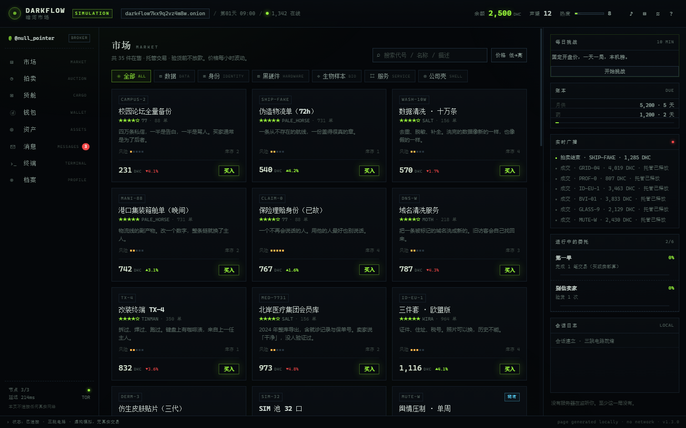
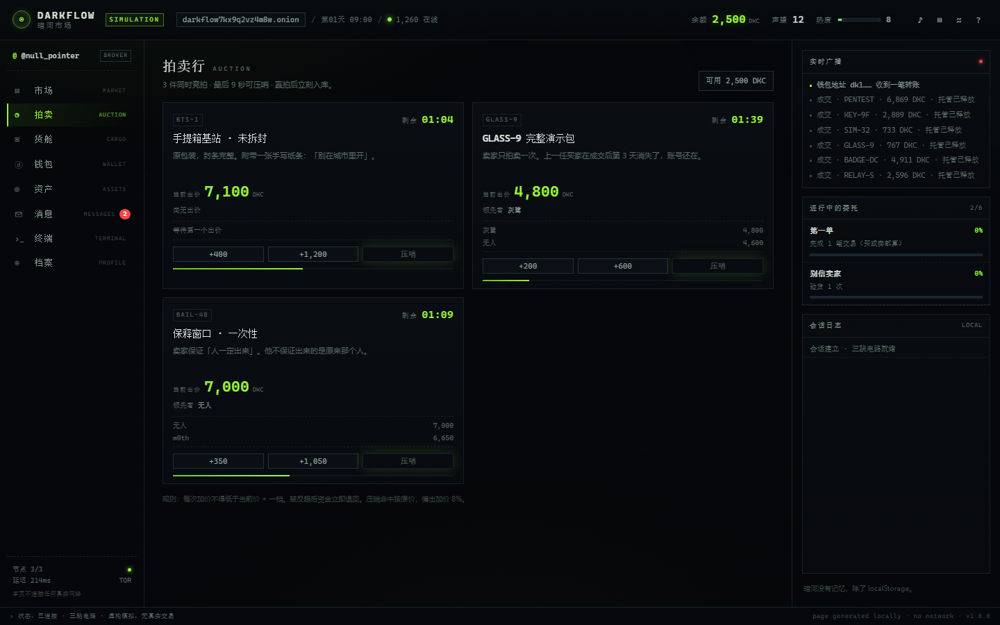
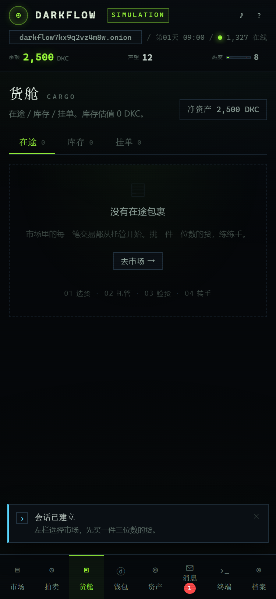
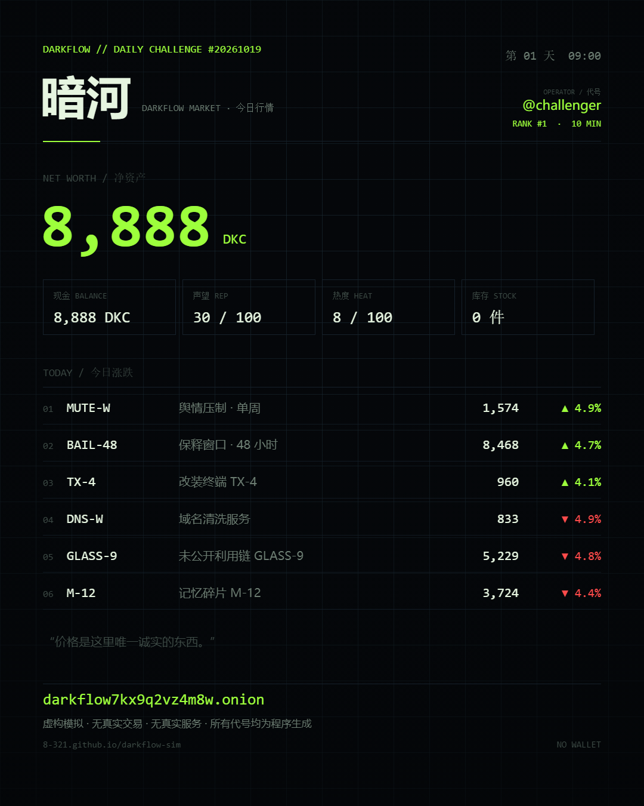
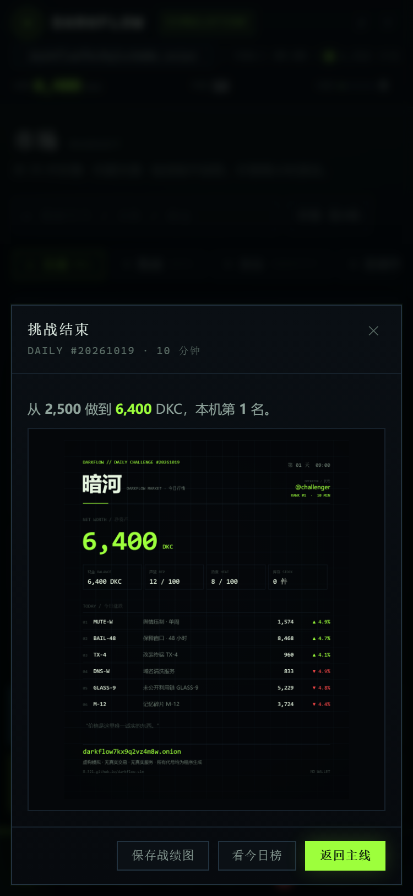
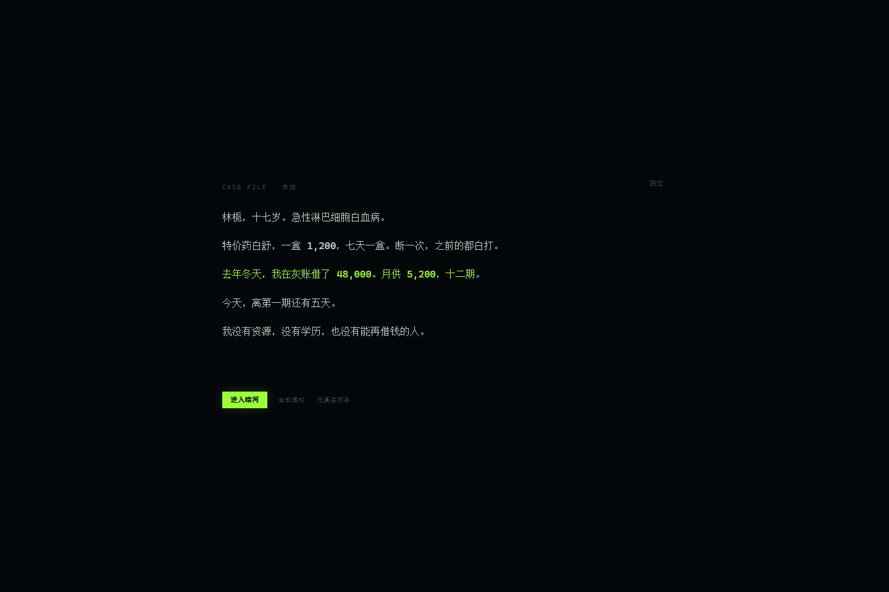
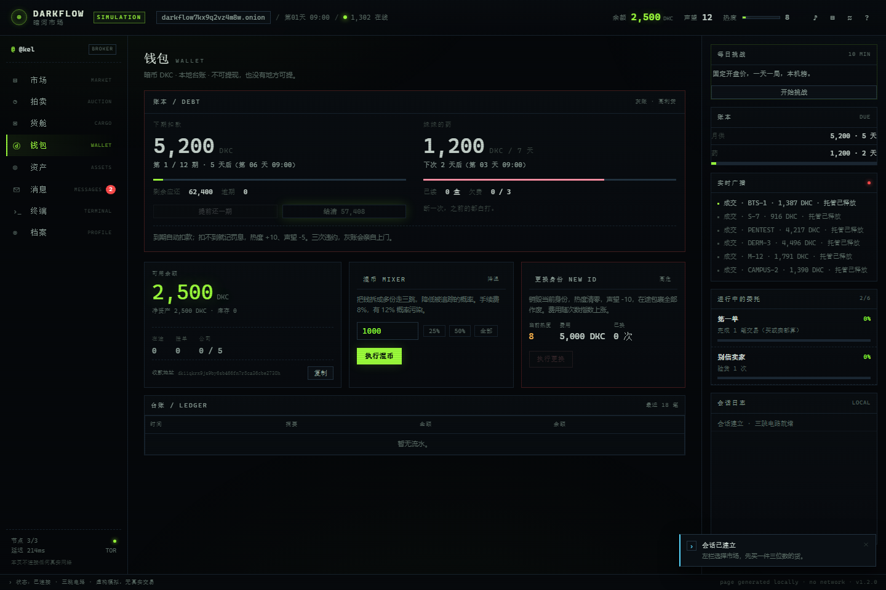
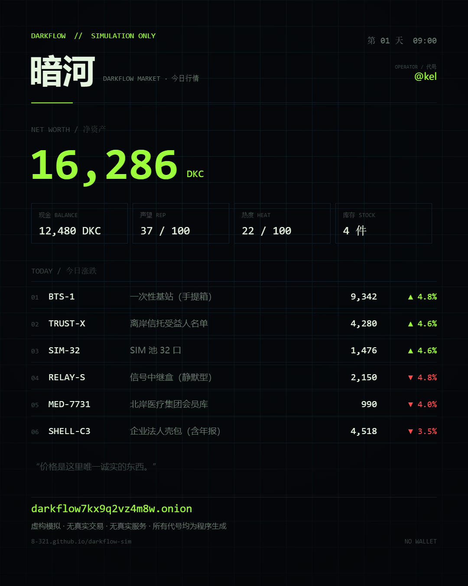

# 暗河 DARKFLOW

> 一个**完全虚构**的暗网市场模拟游戏。你在浏览器里扮演刚入行的中间人，从 2,500 暗币起步，倒卖、拍卖、收购公司、洗热度，活下来并爬上去。

**在线试玩**：https://8-321.github.io/darkflow-sim/
**本地打开**：需要起一个静态服务（浏览器会拦截 `file://` 下的 ES Modules，见 §5）。



| 拍卖（压哨） | 移动端 375px |
|---|---|
|  |  |
|  |  |
|  |  |

**分享卡**：档案 → 生成行情卡，直接导出 1080×1350 PNG。



---

## 0. 免责声明（请先读）

- 本作是**虚构游戏**。所有商品、人物、组织、公司、地址、交易、聊天内容均由程序生成或为剧情设定，**不存在于现实**。
- 页面**不连接任何真实网络**：没有后端、没有 Tor、没有支付、没有第三方接口。标题栏的 `.onion` 地址是虚构字符串，点击只会复制它并提示这是虚构地址。
- 不提供、不指向、不描述任何真实非法服务或可执行方法。游戏内的「禁品」是虚构道具名，用于模拟交易机制与风险，不含任何现实配方、渠道或操作指引。
- 支持纯娱乐与产品交互研究。请勿把游戏内的任何文案当作现实建议。

## 1. 玩法循环

```
选货 → 托管下单 → 等货到 → 验货（可能假货）→ 转手 / 挂单 / 拍卖
   ↑                                                    ↓
   └──────── 收购公司（被动收入）← 洗热度 ← 声望 ←──────┘
```

- **暗币 DKC**：唯一货币。买入即托管，确认收货才放款；被反超会退回冻结资金。
- **热度**：每笔交易、每次赢拍都会加。热度越高越容易遇到「断电 / 临检 / 勒索」事件，满 100 直接被捕结局。
- **声望**：影响可接的委托、议价与解锁。
- **假货**：低价 + 低评分卖家有概率发假货。到货后可扫描验货，选择自用、退回、揭发（涨声望、掉信誉）或转卖（赚差价、砸口碑）。
- **拍卖**：实时倒计时、AI 抬价、最后 9 秒「压哨」小游戏。赢拍拿货，输了退钱。
- **公司**：矿场（每小时收入）、伪造工坊（产出身份货）、物流线（降运费/时效）、情报站（揭假货）、洗币所（降热度）。可升级，也会持续产生痕迹。
- **小游戏**：密码破解（Fallout 风格字符比对）、数据清洗（Simon 记忆序列）、拍卖压哨（时机判定）。
- **结局**：档案里可随时「金盆洗手」（带净资产/声望评级）；热度爆表「被捕」；欠款三次「清算」；断药三次「药停了」。

## 2. 功能清单

| 模块 | 内容 |
|---|---|
| 开机 | 终端逐行打印、三跳电路动画、虚构指纹、跳过 |
| 市场 | 35 件商品、7 大类、搜索、价格排序、涨跌、风险点、库存、评分 |
| 交易 | 托管支付、到货倒计时、验货、假货三选一、挂单转卖、撤单 |
| 拍卖 | 实时竞价、AI 对手、倒计时、压哨小游戏、赢拍/退回 |
| 钱包 | 余额、虚构地址、流水、混币（手续费 + 降低资金痕迹） |
| 资产 | 5 类公司、等级、每小时收益/热度、估值 |
| 消息 | 卖家/中间人会话、未读角标、选项分支 |
| 终端 | 命令解析（help/status/market/buy/crack/clean/netstat…）、杂活面板 |
| 档案 | 身份、统计、委托进度、成就、设置（音效/CRT/动效/重置/存档码/行情卡） |
| 迁移 | 存档码导出/导入（DF1 校验码 + base64，单段文本可粘贴） |
| 分享 | 一键生成 1080×1350「今日行情卡」PNG，可发群 |
| 每日挑战 | 每天一局 10 分钟、按日期固定开盘价、本机榜、带名次的战绩卡 |
| 氛围 | 矩阵雨、扫描线、故障切换、数字滚动、WebAudio 程序化音效 |
| 剧情 | 首次进入的六行序章（妹妹 / 高利贷 / 特价药）；林栀与灰账两条消息线 |
| 账本 | 12 期月供 5,200、七天一盒 1,200，到期自动扣款；违约罚息、提前还款、一次结清；三次违约「清算」，断药三次「药停了」 |

## 3. 操作

- 左侧导航或快捷键：`M` 市场 · `A` 拍卖 · `C` 货舱 · `W` 钱包 · `S` 资产 · `N` 消息 · `T` 终端 · `P` 档案
- `Esc` 关闭弹窗 / 中断小游戏
- 终端支持 `help`、`status`、`market`、`buy <代号>`、`crack`、`clean`、`netstat`、`clear`
- 左栏「每日挑战」：开始 / 继续 / 今日已完成三态；挑战期间顶栏显示 `DAILY mm:ss` 倒计时
- 进度每 10 秒自动存档（localStorage），刷新后可从开机页「继续」

## 4. 技术

- 纯静态：`index.html` + 原生 ES Modules，无框架、无构建、无依赖、无 CDN。
- 视觉：单色近黑 + 酸性荧光绿，1px 硬边，等宽字体；CSS 变量集中管理。
- 音效：WebAudio 实时合成（点击、成交、警报、开机），无音频文件。
- 存档：`localStorage` 三键——主线 `darkflow.save.v1`、挑战 `darkflow.daily.v1`、本机榜 `darkflow.daily.board.v1`；挑战开局前先落盘主线，结束切回。
- 每日挑战：`mulberry32` + 日期种子替换 `Math.random`，同一天两次开局开盘价一致，`exitDaily()` 恢复真随机。
- 响应式：桌面三栏 / 移动端单栏 + 底部导航（375px / 390px 实测无横向溢出）。

```
.
├─ index.html
├─ assets/style.css
├─ js/
│  ├─ data.js        # 虚构数据层（商品/公司/事件/对话）
│  ├─ engine.js      # 状态、时间、市场、交易、拍卖、资产、结局
│  ├─ minigames.js   # 破解 / 清洗 / 压哨
│  ├─ sharecard.js   # 行情卡 Canvas 绘制
│  ├─ audio.js       # WebAudio 音效
│  ├─ ui.js          # 视图与交互
│  └─ main.js        # 启动与自动化接口
├─ docs/             # 截图、研究、验收
└─ 00-PRD-暗河DARKFLOW.md
```

## 5. 本地运行

直接双击 `index.html` 通常打不开：浏览器会以 CORS 拦截 `file://` 下的 ES Modules。任选一种：

```bash
cd 暗网游戏
python -m http.server 5173
# 打开 http://127.0.0.1:5173/
```

或 `npx serve .`。只想发文件给朋友时，用 §6 的 zip 方案，并让对方用同样方式起服务；最省事的是直接发线上链接。

## 6. 部署

**GitHub Pages（当前线上）**：仓库 Settings → Pages → Source 选 `main` / `/ (root)`，静态直出，免费。

**Cloudflare Pages（想绑自己域名时）**：新建项目 → 直传本目录（无构建命令、输出目录 `/`），绑 `game.你的域名`。国内访问建议套 CDN/自定义域，`*.pages.dev` 在部分网络下不稳定。

**私域分发**：整个目录压缩为 zip，发给朋友解压后双击 `index.html`；存档只存在各自浏览器。

## 7. 参考与差异

调研了同类开源/商业项目（详见 `docs/01-研究-开源参考.md`）：Aurora-OS.js、ExitCode、HackShellWeb、DarkWebSimulator、Bitburner、TonyOS、Dark Web Simulator。**未复制任何第三方代码**（Aurora-OS.js 为 AGPL-3.0），只借鉴交互范式：桌面/终端的信息密度、托管交易的两步确认、拍卖的倒计时压迫感。

本作的差异点：中文叙事 + 中间人视角 + 「热度/声望/假货」三重风险，以及把拍卖、公司、验货做成可操作的小游戏，而不是纯点击数值。

## 8. 已知限制

- 单机模拟：没有真实多人、没有服务端，AI 对手是本地概率模型。
- 内容为一次性脚本 + 程序生成，长线重复游玩会见到相同文案。
- 移动端为可用级适配，交互密度仍以桌面为主。
